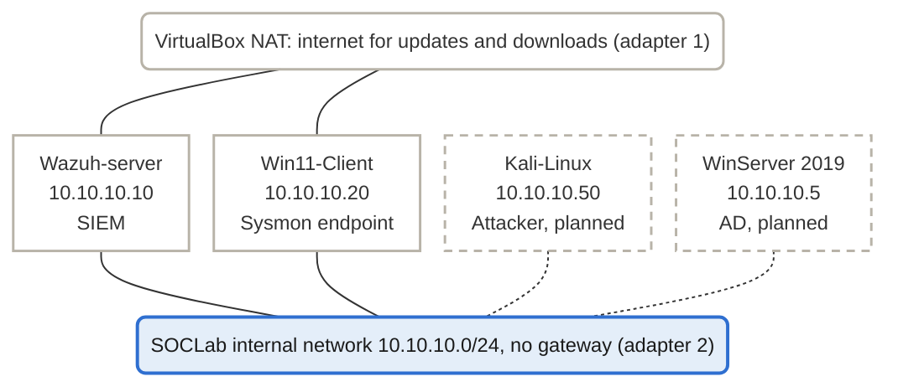

Oct 20, 2026 @Velox

## Overview

Phase 1 of my SOC analyst home lab works on an end to end connection involving a Windows 11 client that runs Sysmon, a Wazuh agent that forwards its logs, and a Wazuh server that shows the events in its dashboard. 

The goal is a lab for SOC 1 applications, build around SIEM use, log analysis, and detections. I will proceed to conduct a write up for each exercise, mapping attacks to an appropriate MITRE ATT&CK matrix. Phase 1 covers the base connections only: one monitored endpoint, one SIEM, and an isolated network. Phase 2 will add attacks and a domain controller. 

- **Monitored endpoint:** Windows 11 Enterprise with Sysmon
- **SIEM:** Wazuh 4.14 all-in-one (server, indexer, dashboard)
- **Platform:** VirtualBox 7.1.6 on a Windows 11 host

**How I built this.** The following lab was created with help from Claude, an AI assistant. The AI was used as a guide to understanding complex details and supplied exact commands and steps for installation. I ran every step in my own VirtualBox lab, read and diagnosed the errors, attempted troubleshooting, referencing Claude if unsuccessful, and scanned through logs. I am using this project to help learn SOC work, the sections below are to mark what I understand and what I need to work on. 
## Lab architecture

Both the Wazuh-server (SIEM) and Win11-Client (Endpoint) machines have been connected to the labs internal network.

Both of the running VMs have an external NAT adapter for updates and downloads, as well as a internal SOCLab adapter to connect to the network of the lab environment. For Phase 2 I plan on connecting both the Kali-Linux (Attack) and WinServer2019 (AD) machines to both the internal and external adapters. 

**Host:** AMD Ryzen 5 5500 (6 cores, 12 threads), 16 GB DDR4-3600 in 2 of 4 slots, 1 Tb NVMe SSD, Windows 11, VirtualBox 7.1.6


| VM                | OS                                         | Role                                      | RAM                                  | Disk            | Lab IP                |
| ----------------- | ------------------------------------------ | ----------------------------------------- | ------------------------------------ | --------------- | --------------------- |
| Wazuh-server      | Ubuntu Server 24.04.5 LTS                  | SIEM: Wazuh 4.14 all-in-one               | 4 GB at creation, raised for indexer | 50GB, no LVM    | 10.10.10.10           |
| Win11-Client      | Windows 11 Enterprise evaluation           | Monitored endpoint (Sysmon + Wazuh agent) | 4 GB                                 | 64 GB           | 10.10.10.20           |
| Kali-Linux        | Kali Linux v6.19, existing VM used for HTB | Attacking machine (Phase 2, planned)      | 4 GB                                 | 64 GB           | 10.10.10.50 (planned) |
| Domain controller | Windows Server 2019 evaluation             | Active Directory (Phase 2, planned)       | 2 to 3 GB (planned)                  | 40 GB (planned) | 10.10.10.5 (planned)  |
**Network Design.** Each VM has two adapters. Adapter 1 is used for external NAT connection, to ensure that the VMs can download and update applications. Adapter 2 joins an internal network called SOCLab, hosted at `10.10.10.0/24`, with static address and no gateway or DNS, so that network traffic stays segmented from the internet. 

**SIEM Dashboard access.** From the host a NAT port-forward maps `127.0.0.1:8443` to the Wazuh VM's port 443. From inside the Win11 VM the dashboard is reachable directly at `https://10.10.10.10`.

**Rule for vulnerable targets.** Since intentionally vulnerable machines, such as Metasploitable 2, can endanger the whole lab environment any addition of such machines should only connect to adapter 2 (SOCLab) and never connect to adapter 1 (NAT)

## Build steps

The build took eight steps, from downloads to Sysmon logs reaching the SIEM. 

1. **Downloads.** Ubuntu Server 24.04.5 LTS (I used the the 24.04 archived version instead of the modern 26.04 version since it runs Wazuh better), Windows 11 Enterprise evaluation, and a Windows Server 2019 evaluation. I reused my already made Kali Linux machine instead if downloading a new one.  
2. **Wazuh VM.** The Wazuh server runs on the base Ubuntu Server 24.04.5 LTS. Created with a 50 GB dynamically allocated disk and two adapters (NAT & Internal Network `SOCLab`). During the install I set a manual IPv4 with a subnet of `10.10.10.0/24` and an address of `10.10.10.10`. I left the gateway and DNS blank, used the whole disk without LVM, and installed OpenSSH. After the first boot i confirmed both interfaces and internet access with `ip a` and a ping, then ran `sudo apt update && apt upgrade`. 
3. **Wazuh install.** Claude supplied me with a single command to install the server, indexer and dashboard on the same host, which then prints the admin credentials:
```bash
curl -sO https://packages.wazuh.com/4.14/wazuh-install.sh && sudo bash ./wazuh-install.sh -a
```
4. **Dashboard access from the host.** On Adapter 1 (NAT) I added a port-forwarding rule: TCP, host `127.0.0.1` port `8443`, guest port `443`. The dashboard then loads at `https://127.0.0.1:8443` after accepting the self-signed certificated warning. 
5. **Windows 11 VM.** 4 GB RAM, 2 CPUs, 64 GB disk, with EFI, Secure Boot and TPM 2.0 enabled, and uses the same two adapters as the Ubuntu Server. I set the static address to `10.10.10.20`and subnet mask to `255.255.255.0`. I verified that it had connection to the NAT adapter with a quick `ip a` and ping. I then checked if the VM was connected to the internal network with a ping to `10.10.10.10`. 
6. **Guest Additions.** Installed from the VirtualBox ISO guest additions to make use of the copy and paste as well as the drag and drop commands. Shared clipboard is only set to Host to Guest as to not allow accidental transfer. 
7. **Wazuh agent.** In the dashboard, under Agents management, I deployed a new agent with the server address 10.10.10.10 and the agent name `Win11-Client`, I then ran the command Wazuh generated in administrative PowerShell, and then started the service with `NET START Wazuh`. 
8. **Sysmon.** I installed Sysmon and then told the Wazuh agent to read the Sysmon channel using the command: 
```powershell
Invoke-WebRequest -Uri "https://download.sysinternals.com/files/Sysmon.zip" -OutFile C:\Tools\Sysmon.zip
Expand-Archive C:\Tools\Sysmon.zip -DestinationPath C:\Tools\Sysmon
Invoke-WebRequest -Uri "https://raw.githubusercontent.com/SwiftOnSecurity/sysmon-config/master/sysmonconfig-export.xml" -OutFile C:\Tools\sysmonconfig.xml
C:\Tools\Sysmon\Sysmon64.exe -accepteula -i C:\Tools\sysmonconfig.xml
```
 I then went to the Wazuh agents configuration file, `ossec.conf`, an inserted the following code above the closing `</ossec_config>` tag: 
```xml
<localfile>
  <location>Microsoft-Windows-Sysmon/Operational</location>
  <log_format>eventchannel</log_format>
</localfile>
```

## Troubleshooting log

Several problems came up, most traced back to memory load, typos, or missing settings. 


| Symptom                                                                      | Cause                                                                                                                                                                                                                     | Fix                                                                                                                           |
| ---------------------------------------------------------------------------- | ------------------------------------------------------------------------------------------------------------------------------------------------------------------------------------------------------------------------- | ----------------------------------------------------------------------------------------------------------------------------- |
| Firefox showed "Unable to connect" at `127.0.0.1:8443`, the Wazuh dashboard. | VirtualBox had not applied the port forward rule. Claude recommended the `netstat -ano \| findstr 8443`, used to if port 8443 is listening, which printed nothing. The dashboard service was active and listening at 443. | Confirmed the rule on Adapter 1 (NAT), saved it, and powered the VM on and off. The dashboard then loaded.                    |
| Dashboard showed the Server API as Offline                                   | `wazuh-manager` had failed, probably because the VM was short of memory.                                                                                                                                                  | Ran `sudo systemctl restart wazuh-manager` to restart the `wazuh-manager` app. All Wazuh feature and API came back active.    |
| Host memory at 96-97% with both VMs running.                                 | The 16 GB RAM in inefficient. The two VMs use about 7GB, plus the use of the browser, Windows defender, and other apps.                                                                                                   | Closed unused apps, reduced the Wazuh servers VM's memory. A upgrade to 32GB is planned.                                      |
| Agent never showed 'Never connected' and then 'Pending'                      | Service not started yet                                                                                                                                                                                                   | Ran `NET START Wazuh` and waited a short bit for agent to become active.                                                      |
| Sysmon install command failed.                                               | Ran into typo issues when hand typing out the download file for Sysmon. This caused the download to fail a couple of times while fixxing errors.                                                                          | Ran the commands one at a time and double checked they were correct. Followed by setting up Guest Additions to use clipboard. |
| Agent log error `EvtSuscribe() ... (15007)` for the Sysmon channel.          | Their was a leading space inside the `<location>` value of the `ossec.conf` file.                                                                                                                                         | Removed the space on line 211 of the `ossec.conf` file and restarted the agent. The log showed a clean 'Analyzing event log'  |

## Lessons learned 

- **Memory is the limit.** When only running on 16 GB of RAM running multiple high memory use VMs I will quickly run out of memory. A upgrade to at least 32 GB of RAM is required if I want to run multiple VMs comfortably. 
- **Check each line of code when manually typing.** Many of my errors from this lab can be determined to be from not double checking my commands before entering them. I need to ensure I double and triple check all my commands. 
- **Alerts are not raw logs.** When I first logged into the Wazuh server I did a quick check using PowerShell commands, opening a calculator, and using notepad. Only the PowerShell commands were shown because Wazuh only shows events by rules unless archiving is on. 
- **Paste when can, limit typing.** Pasting can help limit syntax errors and save time when dealing with lengthy commands, as compared to typing. 
- **Snapshot every change.** Less of a lessons learned more of a reminder. 

## Still Learning

- **How to navigate the Wazuh dashboard.**
- **How to read different types of Wazuh logs.**
- **Writing custom Wazuh detection rules.**
- **Mapping activity to MITRE ATT&CK matrix**
- **How to write proper incident reports.**
